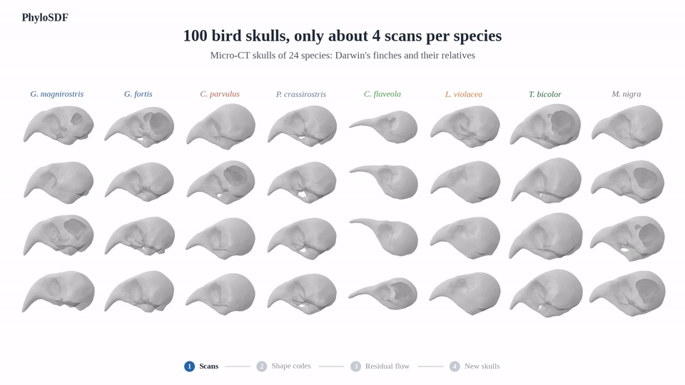

# PhyloSDF

**Phylogenetically-regularized neural generation of 3D skull morphology via residual flow matching**

Kaikwan Lau and Gary P. T. Choi · [arXiv preprint](https://arxiv.org/abs/2604.25371), 2026.

[](docs/assets/PhyloSDF_15s.mp4)

Code and meshes accompanying the paper: 100 original skull inputs, 12 saved generated figure meshes, and two anatomical-audit examples.

## Mesh downloads

**[Browse meshes](meshes/README.md)** in two main folders: **[GMM](meshes/GMM/README.md)** and **[generated — PhyloSDF only](meshes/generated/README.md)**. The full archive index retains all 7,305 STL files (65.90 GB across 12 GitHub releases).

## Contents

| Folder | Contents |
| :--- | :--- |
| [`data/`](data/) | Original STL inputs, species labels and dated-tree distances |
| [`outputs/`](outputs/) | Saved generated meshes, STL examples and source checksums |
| [`meshes/`](meshes/) | GMM/PhyloSDF catalogues and the full 7,305-file archive index |
| [`code/tree_comparison/`](code/tree_comparison/) | Main dated-tree sampler comparison |
| [`code/studies/`](code/studies/) | Component, supervision, withheld-species and anatomy studies |

## Quick start

Download and extract the repository, then run:

```bash
python -m pip install -r requirements.txt
python quickstart.py
```

This verifies the 100 input meshes and saves three views of a released generated skull to `output/quickstart/inspection.png`. No GPU or model weights are needed for this example.

For training, generation and evaluation, see the [reproduction guide](docs/REPRODUCE.md). Full experiments require the recorded processed inputs, checkpoints and a CUDA GPU.

Figure meshes use normalized decoder coordinates; anatomical examples use millimetres. Their [mesh notes](outputs/README.md) identify the source experiments and extraction details.

Original inputs come from [skull-morphology](https://github.com/kaikwanlau/skull-morphology). Please retain the [source attributions and data terms](data/source_meshes/README.md).
